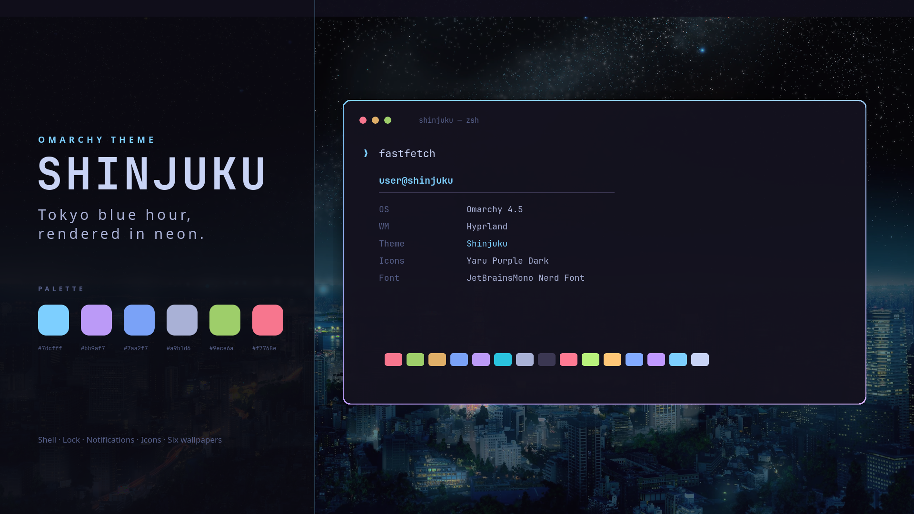
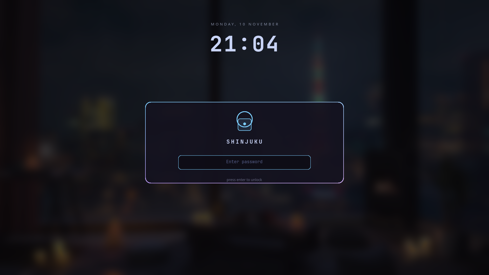
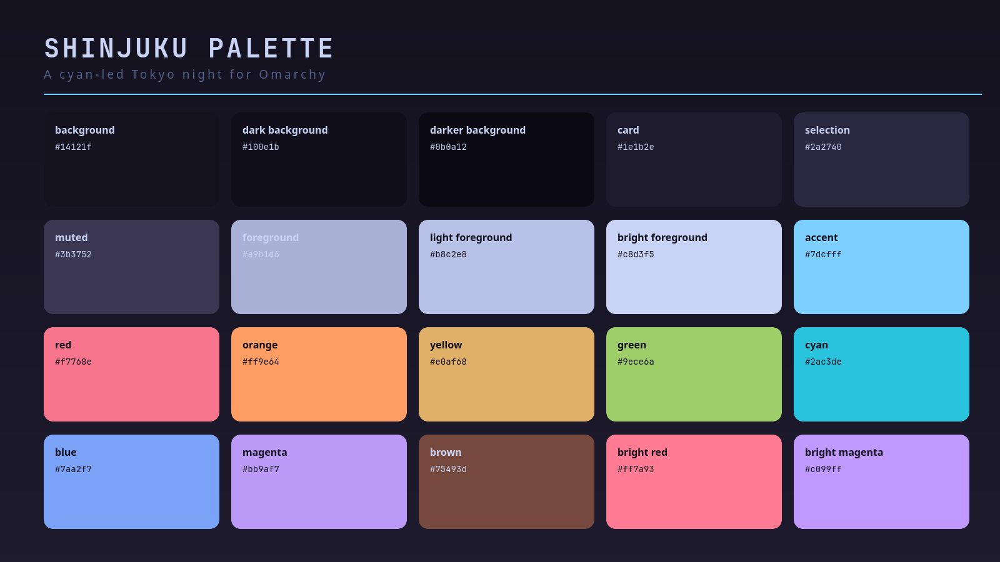

# Shinjuku

A dark Omarchy theme inspired by Tokyo Night, pushed further into blue hour:
violet-black surfaces, moonlight text, and a neon-cyan signature with
cyan-to-violet gradient borders.



```bash
omarchy theme install https://github.com/selomrani/omarchy-shinjuku-theme.git
```

This theme is published at
[github.com/selomrani/omarchy-shinjuku-theme](https://github.com/selomrani/omarchy-shinjuku-theme).
Omarchy takes the theme name from the repository name, so keep it called
`omarchy-shinjuku-theme` when you fork it (the `omarchy-` prefix and `-theme`
suffix are stripped, leaving `shinjuku`). Installing applies **Shinjuku**
automatically.

## Highlights

- **Neon-cyan lead accent** (`#7dcfff`) over a violet-black base (`#14121f`),
  with the familiar Tokyo Night accent family for terminals and editors.
- **Gradient edges** — focused windows, popups, and notifications use a
  cyan-to-violet 45° gradient.
- **Custom shell surfaces** — a near-opaque dark bar, lighter flyout cards,
  accent-tinted hover/focus/selection states, a translucent launcher, and a
  themed lock and polkit prompt.
- **Six wallpapers** in 16:9, rotated with `omarchy theme bg next`.
- **Full app coverage** — every config Omarchy generates is derived from one
  `colors.toml`, so the theme stays consistent across terminals, editors,
  the browser, and the shell.
- **Accessible by default** — body text is 8.8:1 on the background and the
  accent is 10.8:1; see [Accessibility](#accessibility).



## Installation

### From the repository (recommended)

```bash
omarchy theme install https://github.com/selomrani/omarchy-shinjuku-theme.git
```

The command clones the repo to `~/.config/omarchy/themes/shinjuku` and applies
it. To update later:

```bash
omarchy theme update
```

### Manual / development copy

```bash
git clone https://github.com/selomrani/omarchy-shinjuku-theme.git \
  ~/.config/omarchy/themes/shinjuku
omarchy theme set Shinjuku
```

For local development, symlink a working copy instead of cloning into the
themes directory. Omarchy treats a symlinked theme as your own, so you can
re-apply after every edit:

```bash
ln -s ~/code/omarchy-shinjuku-theme ~/.config/omarchy/themes/shinjuku
omarchy theme set Shinjuku
```

### Uninstall

```bash
omarchy theme set "Tokyo Night"   # or any other theme
omarchy theme remove Shinjuku
```

## What's included

| File | Purpose |
| --- | --- |
| `colors.toml` | The single source of truth for every generated app color, plus the gradient border definition. |
| `shell.toml` | Full shell surface styling: bar, flyouts, tooltips, notifications, launcher, menus, polkit, lock, and image picker. |
| `backgrounds/` | Six 2560×1440 WebP wallpapers. |
| `icons.theme` | Yaru Purple Dark icon set. |
| `keyboard.rgb` | Cyan backlight for supported keyboards. |
| `chromium.theme` | Browser chrome tint for Chromium, Chrome, Edge, and Brave. |
| `preview.png`, `preview-unlock.png` | Preview renders used by this README. |
| `palette.png` | A card showing every core color with its hex value. |

Omarchy generates the rest at apply time from `colors.toml`: terminal configs
(Alacritty, foot, Ghostty, Kitty), btop, Helix, Neovim, VS Code, Obsidian,
tmux, fcitx5, Hyprland borders, and the GNOME color mode.

> **Why the repo has no `neovim.lua` or terminal configs:** Omarchy
> intentionally drops Lua, terminal configs, and `vscode.json` from themes
> installed via git, because those files can run code. They are regenerated
> from `colors.toml` instead. Neovim gets the exact Shinjuku palette through
> [aether.nvim](https://github.com/omacom/aether.nvim), so nothing is lost.

## Palette



| Role | Hex | Use |
| --- | --- | --- |
| Background | `#14121f` | Desktop surfaces, cards, terminals |
| Darker background | `#0b0a12` | Bar, scrims |
| Card background | `#1e1b2e` | Flyouts, notifications, menus |
| Selection | `#2a2740` | Text selection |
| Muted | `#3b3752` | Borders, dividers |
| Foreground | `#a9b1d6` | Body text |
| Bright foreground | `#c8d3f5` | Titles, selected text |
| Accent | `#7dcfff` | Focus, selections, active border |
| Magenta | `#bb9af7` | Gradient partner, violet highlights |
| Red | `#f7768e` | Errors, recording |
| Yellow / orange | `#e0af68` / `#ff9e64` | Warnings |
| Green | `#9ece6a` | Success |
| Blue | `#7aa2f7` | Links, information |

The full 20-color palette is in [`palette.png`](palette.png) and
[`colors.toml`](colors.toml).

## Accessibility

Contrast ratios are measured against the main background (`#14121f`):

| Token | Ratio | Notes |
| --- | --- | --- |
| Foreground | **8.76:1** | AAA for normal text |
| Bright foreground | **12.40:1** | AAA |
| Accent | **10.78:1** | AAA |
| Red | **6.99:1** | AAA |
| Green | **10.11:1** | AAA |
| Yellow | **9.24:1** | AAA |
| Magenta | **7.99:1** | AAA |
| Blue | **7.34:1** | AAA |

`muted` (1.63:1) and `dark_foreground` (2.99:1) are intentionally low
contrast and should stay decorative — borders, dividers, and captions. If you
need secondary text to be readable, use `foreground` or `bright_foreground`.

Interactive states do not rely on hue alone: hover, focus, and selection each
add a border and a fill change, so they remain distinguishable with reduced
color perception.

## Customization

1. Edit `colors.toml` (and `shell.toml` for literal shell colors).
2. Re-apply: `omarchy theme set Shinjuku`.
3. Cycle a different wallpaper: `omarchy theme bg next`.

Add personal wallpapers to `~/.config/omarchy/backgrounds/shinjuku/`; they join
the rotation without touching the repository.

The bar background is a per-user setting rather than a theme file:

```bash
omarchy bar background glassy   # frosted: blurred wallpaper behind the bar
omarchy bar background opaque   # solid bar using the theme color
omarchy bar background none     # fully clear bar
```

Pick `glassy` for the intended blurred look. `none` ignores the theme's bar
color entirely, so it will read as see-through.

The gradient lives in `colors.toml`:

```toml
hyprland_active_border = "#7dcfff #bb9af7 45deg"
```

Change the two colors or the angle to retint every focused border at once.

## Compatibility

- **Omarchy 4.5+** (developed against 4.5.0-3).
- Icons expect the **Yaru** family, which ships with Omarchy.
- The keyboard color only affects supported hardware; elsewhere it is ignored.
- `chromium.theme` applies to Chromium-based browsers through Omarchy's
  managed browser policy.

## Credits

- Palette family inspired by [Tokyo Night](https://github.com/folke/tokyonight.nvim)
  by folke. Shinjuku is an original palette, not a port.
- Built for [Omarchy](https://omarchy.org).
- Wallpapers belong to their original artists; see [WALLPAPERS.md](WALLPAPERS.md).

## License

[MIT](LICENSE) for the theme configuration and documentation. The wallpapers
are excluded from that license and remain the property of their creators.
